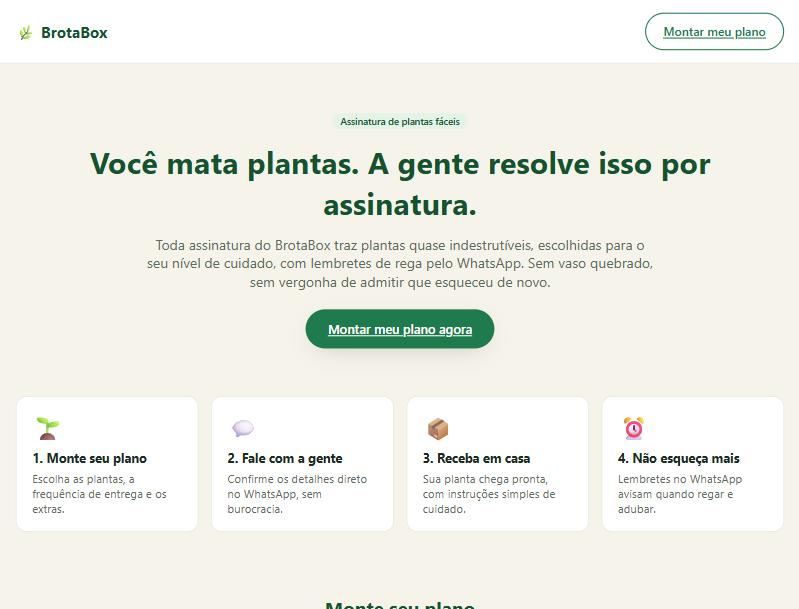
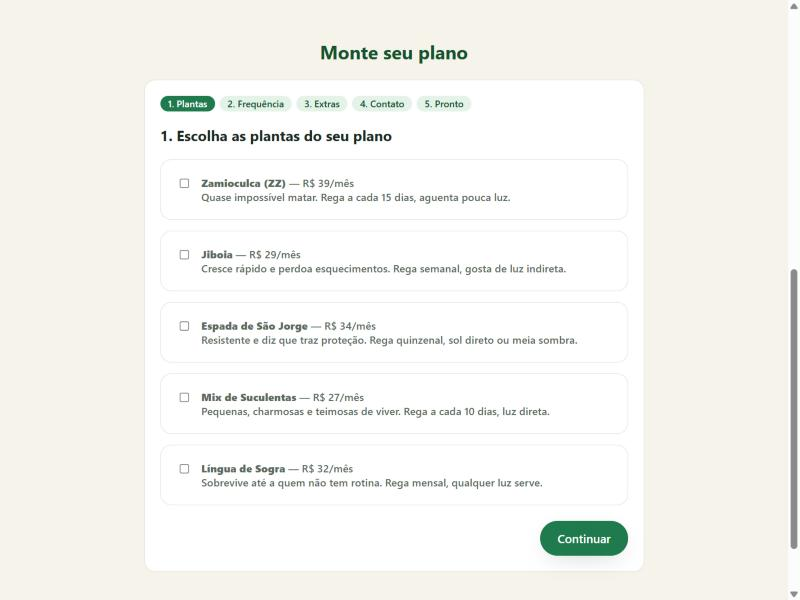
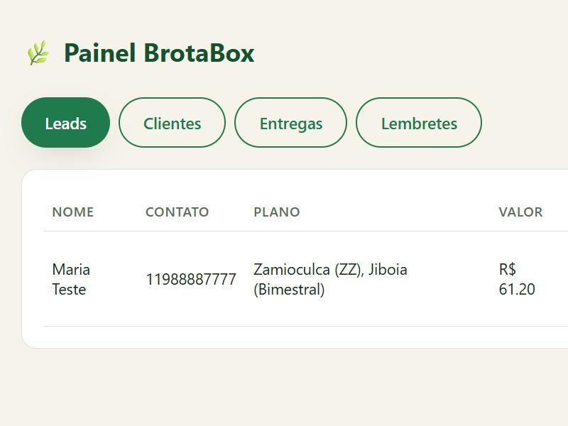

# 🌿 BrotaBox — assinatura de plantas para quem mata plantas

MVP de um negócio de assinatura de plantas fáceis de cuidar, construído como projeto de
portfólio (desafio "da ideia ao MVP, com IA como cofounder"). A tese: **gente que já matou
planta assina se a gente escolher plantas difíceis de matar e mandar lembrete de cuidado**.

🔗 **Aplicação publicada:** https://brotaboxassinaturaplantas.vercel.app
🔗 **API:** https://brotaboxapiprod.up.railway.app (hospedada no Railway)



## A dor escolhida

Muita gente compra uma planta, se anima por duas semanas, esquece de regar (ou rega demais)
e em um mês ela está morta. Isso não é falta de gostar de plantas — é falta de rotina e de
orientação simples no momento certo. A pessoa se sente mal, não compra outra, e desiste de
ter plantas em casa.

Essa dor vale um negócio porque ela é recorrente (quem mata uma planta tende a matar a
próxima também, então o problema não se resolve sozinho), afeta um público amplo (qualquer
pessoa com casa/apartamento) e tem uma solução simples de testar sem grandes investimentos:
plantas resistentes + lembretes, vendidos por assinatura.

## Tamanho de mercado e Business Model Canvas

A análise completa (TAM, SAM, SOM e o Business Model Canvas nos 9 blocos) está em
[`docs/validacaodonegocio.md`](docs/validacaodonegocio.md). Resumo:

| Camada | Estimativa |
|---|---|
| TAM — mercado brasileiro de plantas ornamentais | ~R$ 8 bilhões/ano |
| SAM — moradores urbanos com perfil de compra online de plantas | ~2 milhões de pessoas (~R$ 840 milhões/ano) |
| SOM — meta realista do BrotaBox no ano 1, operando manualmente | ~1.000 assinantes (~R$ 504 mil/ano) |

## A tese do MVP e o que ficou manual de propósito

**Tese testada:** pessoas que já mataram plantas pagam por uma assinatura de plantas
resistentes com lembretes de cuidado, mesmo com o atendimento e o pagamento totalmente
manuais.

O MVP prova (ou derruba) isso com o mínimo de engenharia possível. Por isso, ficou manual de
propósito:

- **Pagamento** — a venda é fechada pelo WhatsApp e o link de pagamento (Pix/cartão) é
  enviado à mão. Não há checkout integrado.
- **Logística de entrega** — a compra junto ao viveiro e o agendamento do entregador são
  combinados manualmente; o painel só registra data e itens da entrega.
- **Alerta de novo lead por email** — fica para a seção "Ideias para evoluir" abaixo; hoje o
  administrador consulta o painel diretamente.
- **Marketplace/múltiplos fornecedores** — fica para depois que a tese se confirmar.

As quatro hipóteses específicas que o MVP testa (desejabilidade, preço, canal de venda
manual e personalização do plano) estão detalhadas em
[`docs/validacaodonegocio.md`](docs/validacaodonegocio.md#4-hipóteses-que-o-mvp-precisa-testar).

## O mega prompt e as correções

O prompt único (fluxo do cliente, painel de administração e cores) usado como especificação
do MVP, mais a lista de correções pedidas depois do primeiro teste, está em
[`docs/megaprompt.md`](docs/megaprompt.md).

## O que o MVP entrega

- **Landing page** que explica a proposta (`/`).
- **Formulário em etapas** para montar o próprio plano: plantas → frequência → extras →
  contato, com valor estimado calculado em tempo real.
- **Botão "Falar no WhatsApp"** que abre uma conversa com o número do negócio e uma mensagem
  pronta, resumindo o plano montado — e que só aparece depois que o lead já foi salvo no
  backend (então ele aparece no painel mesmo que a pessoa não envie a mensagem).
- **Painel de administração** (`/admin`, protegido por chave de administrador) com:
  - **Leads**: quem preencheu o formulário, com plano, valor e status; ação para converter em
    cliente (pedindo endereço de entrega) ou remover.
  - **Clientes**: assinantes ativos, com plano, endereço e status.
  - **Entregas**: agendar entregas por cliente e acompanhar status (agendada → enviada →
    entregue / atrasada).
  - **Lembretes**: criar lembretes (rega, adubo, cobrança, renovação) por cliente e marcar
    como feito.




## Stack

- **Frontend**: React 19 + TypeScript + Vite, roteamento com `react-router-dom`, sem
  biblioteca de UI (CSS próprio, tema verde/terracota).
- **Backend**: Node.js + Express, armazenamento em arquivo JSON via `lowdb` (sem banco de
  dados externo — suficiente para o volume de um MVP em validação).
- Nenhuma chave real, token ou senha está versionada: `server/.env` e `client/.env` são
  ignorados pelo Git; use os arquivos `.env.example` como referência.

## Estrutura do repositório

```
brotabox/
├── client/              # Frontend React + Vite
│   └── src/
│       ├── pages/        # Landing.tsx, Admin.tsx
│       ├── components/   # PlanBuilder.tsx, components/admin/*Tab.tsx
│       └── lib/          # api.ts, data.ts (catálogo), whatsapp.ts
├── server/              # API Express
│   ├── src/index.js      # rotas de leads, clientes, entregas, lembretes
│   └── data/db.json      # "banco" em arquivo (gerado em runtime, não versionado)
└── docs/
    ├── validacaodonegocio.md     # TAM/SAM/SOM, BMC, hipóteses
    ├── megaprompt.md             # prompt usado + correções
    └── screenshots/              # prints do app
```

## Como rodar localmente

Prérequisitos: Node.js 20+.

```bash
# 1. Backend
cd server
npm install
cp .env.example .env   # ajuste ADMIN_KEY se quiser
npm run dev             # roda em http://localhost:4000

# 2. Frontend (em outro terminal)
cd client
npm install
cp .env.example .env    # aponta para a API local
npm run dev              # roda em http://localhost:5173
```

Acesse `http://localhost:5173` para a landing page e `http://localhost:5173/admin` para o
painel (use a `ADMIN_KEY` definida em `server/.env`).

⚠️ **Antes de publicar de verdade:** troque o número de WhatsApp de exemplo em
[`client/src/lib/whatsapp.ts`](client/src/lib/whatsapp.ts) pelo número real do negócio, e
defina um `ADMIN_KEY` forte em produção.

## Ideias para evoluir

- Configurar o Resend para o alerta de novo lead chegar por email.
- Mandar os dados do formulário também no corpo da mensagem do WhatsApp (hoje já vai um
  resumo; dá para detalhar mais).
- Gerar o manual da marca em PDF para quem for continuar o projeto.
- Receber o pagamento pela própria aplicação, com o Stripe.
- Colocar um chatbot no WhatsApp com o n8n para préqualificar leads antes do atendimento humano.
